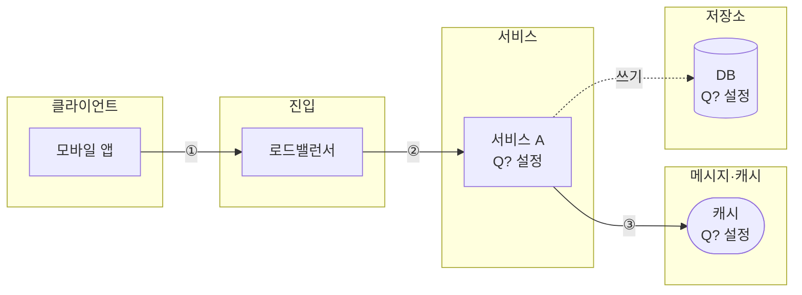

# 시스템 전체 설계도 그리기 (모든 장 공통)

결과 문서 `3. 시스템 전체 설계도`를 그리는 규칙이다. 미팅에서 여러 사람의 그림을 **같은 문법으로** 읽기 위해 장마다 바꾸지 않는다.

- **mermaid**: 항상 그린다. 결과 문서 안에 넣는다(Obsidian, GitHub에서 바로 렌더링된다).
- **excalidraw**: 사용자가 원할 때만 추가로 만든다. 별도 파일로 만들고 결과 문서에 임베드한다.

두 그림은 **같은 노드, 같은 연결**이어야 한다. mermaid를 먼저 확정하고, excalidraw는 그것을 옮겨 그린다.

## 공통 규칙

1. **사용자가 고른 컴포넌트만** 넣는다. "캐시 없음"을 골랐으면 캐시를 그리지 않는다.
2. **계층(lane) 4~5개**로 나눈다. 왼쪽 → 오른쪽: `클라이언트` → `진입` → `서비스` → `메시지·캐시` → `저장소`. 비는 계층은 뺀다.
3. **노드 15개 이하.** 같은 역할의 서버 여러 대는 노드 하나로 그리고 `× N`으로 적는다.
4. **노드 라벨 = 이름 + 결정 번호 + 핵심 설정 한 줄.** 예: `LBS<br/>Q4 지오해시 6/5/4`, `부 DB × 3<br/>Q6 사본 증설`
5. **선 종류는 세 가지만** 쓴다.
   | 선 | 뜻 |
   |---|---|
   | 실선 `-->` | 핵심 흐름 (`chapter.md`의 핵심 흐름: 1장 주변 검색, 2장 위치 갱신 전파) |
   | 점선 `-.->` | 쓰기, 복제, 비동기, 부가 흐름 |
   | 굵은 선 `==>` | 돌발 상황 대응으로 추가된 경로 |
6. 핵심 흐름의 선에는 `①②③` 순번 라벨을 단다. 결과 문서의 핵심 흐름 한 줄과 번호를 맞춘다.
7. 그림 아래에 범례 한 줄: `실선 = <핵심 흐름> · 점선 = 쓰기·비동기 · 굵은 선 = 돌발 대응`

## mermaid 문법

노드 모양:

| 대상 | 모양 | 예 |
|---|---|---|
| 클라이언트, 서비스, 서버 | `[ ]` | `LBS[LBS<br/>Q4 지오해시]` |
| 저장소(DB) | `[( )]` | `Primary[(주 DB)]` |
| 캐시 | `([ ])` | `GeoCache([지오해시 캐시<br/>Q7])` |
| 메시지 버스, 펍/섭, 큐 | `{{ }}` | `PubSub{{레디스 펍/섭 × 140<br/>Q4 사용자별 채널}}` |

뼈대:



주의: 노드 ID는 영문(공백 없음), 라벨에만 한글. 라벨에 괄호·따옴표가 있으면 `"..."`로 감싼다.

## excalidraw (선택)

### 언제 만드나
마무리 단계에서 mermaid를 확인받을 때 "excalidraw 파일도 만들까요?"라고 **한 번** 묻는다. 원하면 만든다.
(vault에 Obsidian Excalidraw 플러그인이 설치되어 있어야 열린다.)

### 파일
- 이름: 결과 파일 이름에서 `.md`를 `.excalidraw.md`로 바꾼다. 예: `근접성설계_동조_2026-10-18.excalidraw.md`
- 위치: 결과 파일과 같은 디렉터리
- 결과 문서 `3. 시스템 전체 설계도`의 mermaid 아래에 `![[근접성설계_동조_2026-10-18.excalidraw]]`를 넣는다.

### 만드는 방법: spec → 스크립트

좌표를 직접 계산하지 않는다. 확정한 mermaid를 **spec JSON**으로 옮기고 `scripts/excalidraw.py`로 변환한다.
(스크립트가 계층별 배치, 색, 선 종류, 상자-글자-화살표 연결까지 처리한다.)

1. mermaid와 같은 노드·연결로 spec을 임시 파일(예: `/tmp/<이름>-spec.json`)에 쓴다.
   - `lanes`: mermaid의 subgraph 순서 그대로 (빈 계층은 뺀다)
   - `nodes`: `id`(mermaid 노드 ID), `lane`(lanes 인덱스), `row`(계층 안 위→아래 0부터. 핵심 흐름 노드를 row 0에 두면 실선이 수평으로 곧게 그려진다), `label`(줄바꿈은 `\n`), `kind`
   - `kind`: `client`(클라이언트·진입) / `svc`(서비스) / `cache` / `bus`(메시지 버스·펍/섭·큐) / `db`(저장소, 타원)
   - `edges`: `from`, `to`, `label`(선택), `style` = `solid`(핵심 흐름) / `dashed`(쓰기·비동기) / `bold`(돌발 대응)
   - `legend`: 범례 한 줄
2. 실행: `python3 -I <스킬 폴더>/scripts/excalidraw.py /tmp/<이름>-spec.json <결과 파일 디렉터리>/<결과 파일 이름>.excalidraw.md`
3. 결과 문서 `3. 시스템 전체 설계도`의 범례 아래에 `![[<결과 파일 이름>.excalidraw]]`를 넣는다.

spec 예시 (ch01 · S1 동네맛집, `output-template.md` 작성 예시의 mermaid와 같은 그림):

```json
{
  "lanes": ["클라이언트", "진입", "서비스", "저장소"],
  "nodes": [
    {"id": "app", "lane": 0, "row": 0, "label": "모바일 앱", "kind": "client"},
    {"id": "owner", "lane": 0, "row": 1, "label": "사장님 앱", "kind": "client"},
    {"id": "lb", "lane": 1, "row": 0, "label": "로드밸런서", "kind": "client"},
    {"id": "lbs", "lane": 2, "row": 0, "label": "LBS\nQ4 지오해시 4~6", "kind": "svc"},
    {"id": "biz", "lane": 2, "row": 1, "label": "사업장 서비스\nQ3 분리", "kind": "svc"},
    {"id": "replica", "lane": 3, "row": 0, "label": "부 DB × 3\nQ5 복합 키 색인", "kind": "db"},
    {"id": "primary", "lane": 3, "row": 1, "label": "주 DB\nQ5 RDB", "kind": "db"},
    {"id": "hot", "lane": 3, "row": 2, "label": "핫스팟 임시 DB\nQ6 돌발", "kind": "db"}
  ],
  "edges": [
    {"from": "app", "to": "lb", "label": "①"},
    {"from": "lb", "to": "lbs", "label": "②"},
    {"from": "lbs", "to": "replica", "label": "③④"},
    {"from": "lbs", "to": "hot", "label": "핫스팟", "style": "bold"},
    {"from": "owner", "to": "lb", "label": "수정", "style": "dashed"},
    {"from": "lb", "to": "biz", "style": "dashed"},
    {"from": "biz", "to": "primary", "label": "쓰기", "style": "dashed"},
    {"from": "primary", "to": "replica", "label": "복제", "style": "dashed"},
    {"from": "primary", "to": "hot", "label": "동기화 미정", "style": "bold"}
  ],
  "legend": "실선 = 주변 검색 · 점선 = 쓰기·비동기 · 굵은 빨간 선 = 돌발 대응"
}
```

### 만든 뒤
- 사용자에게 "Obsidian에서 열어 보고, 선이 겹치는 곳은 손으로 옮겨 달라"고 안내한다. 자동 배치는 격자 정렬까지만 한다.
- 스크립트를 실행할 수 없거나 결과가 깨지면: 결과 문서의 mermaid 코드를 복사해 Excalidraw 플러그인의 명령 팔레트 → **"Insert/Edit Mermaid"**로 변환하는 방법을 알려준다.
