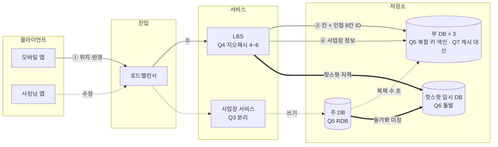

# 결과 문서 양식 (모든 장 공통)

미팅에서 서로의 결과를 **같은 순서, 같은 칸**으로 읽기 위한 한 장짜리 양식이다.

규칙:
- **섹션은 아래 5개뿐이다.** 추가하지 않는다. 전체 80줄 안쪽(설계도 포함).
- `3. 시스템 전체 설계도`는 `diagram-guide.md` 규칙(계층, 노드 모양, 선 세 종류, 결정 번호 라벨)을 따른다.
- 표 칸은 **한 줄**. 근거와 감수한 것은 사용자 표현을 살려 압축한다. 진행자가 지어내지 않는다.
- 시나리오 카드 전체를 옮기지 않는다. 교재와 다른 제약만 적는다.
- `<...>` 안의 장별 값은 `chapter.md`의 `결과 문서에 들어갈 값`을 쓴다.
- `패스`한 질문은 선택 칸에 `미결정 (가정: ...)`, 진행하지 않은 질문은 `미진행`.
- 진행자 코멘트, 계산 풀이, 흐름 점검 같은 해설은 문서에 넣지 않는다(채팅으로만).

---

````markdown
---
title: <장 제목> — <이름>
chapter: <ch01>
scenario: <S1 동네맛집>
date: YYYY-MM-DD
tags:
  - system-design
  - <chapter.md 의 tag>
---

# <장 제목> — <이름> · <시나리오>

> **한 줄 요약**: <핵심 결정 2~3개를 한 문장으로>

## 1. 전제

| 핵심 숫자 | 값 | 계산식 |
|---|---|---|
| <chapter.md 의 핵심 숫자 1> | ... | ... |
| <핵심 숫자 2> | ... | ... |

- **교재와 다른 제약**: <시나리오에서 교재 가정을 깨는 것 1~2개>

## 2. 결정 7개

| # | 결정 | 내 선택 | 근거 (한 줄) | 감수한 것 |
|---|---|---|---|---|
| Q1 | ... | ... | ... | ... |
| ... | | | | |
| Q7 | ... | ... | ... | ... |

> 바뀐 결정: Qn A → B (꼬리 질문 / 돌발) — 있을 때만

## 3. 시스템 전체 설계도

```mermaid
flowchart LR
  %% diagram-guide.md: 계층 subgraph 4~5개, 노드 15개 이하, 사용자가 고른 컴포넌트만
  %% 라벨 = 이름 + 결정 번호 + 핵심 설정 / 실선 = 핵심 흐름, 점선 = 쓰기·비동기, 굵은 선 = 돌발 대응
```

실선 = <핵심 흐름> · 점선 = 쓰기·비동기 · 굵은 선 = 돌발 대응

<!-- excalidraw 를 만든 경우에만: ![[<결과 파일 이름>.excalidraw]] -->

**<chapter.md 의 핵심 흐름>**: ① ... → ② ... → ③ ... (최대 7단계, 그림의 ①②③과 번호를 맞춘다)

## 4. 교재와 다르게 간 곳

| 결정 | 교재 | 나 | 이 시나리오에서 왜 |
|---|---|---|---|
| ... | ... | ... | ... |

(최대 3행. 교재와 같으면 "교재와 같음" 한 줄)

## 5. 미팅 안건

- **가장 자신 없는 결정**: ...
- **같이 이야기할 질문**: <진행자가 이 설계에서 1개>
````

---

## 작성 예시 (ch01 · S1 동네맛집)

````markdown
# 1장 근접성 서비스 — 동조 · S1 동네맛집

> **한 줄 요약**: 지오해시 + RDB 주-부 + 복합 키 색인, 캐시 없이 사본 증설로 읽기를 받고, 사장님 수정은 수 분 안에 반영한다.

## 1. 전제

| 핵심 숫자 | 값 | 계산식 |
|---|---|---|
| 평균 / 피크 검색 QPS | 1,000 / 5,000 | 1,000만 × 10 / 10⁵, × 5 |
| 데이터 크기 | 색인 수백 MB, 사업장 수 GB | 300만 행 |

- **교재와 다른 제약**: 한국 전용, 강남과 산간의 밀도 편차가 극단적

## 2. 결정 7개

| # | 결정 | 내 선택 | 근거 (한 줄) | 감수한 것 |
|---|---|---|---|---|
| Q1 | 규모 | 피크 5,000 QPS, 읽기 위주 | 피크에 DB가 먼저 병목 | — |
| Q2 | 반영 시점·반경 | 수 분 이내 / 고정 반경 + 부족 시 자동 확장 | 셀프 입력인데 다음날 반영은 나쁜 경험 | 피크 시간 수정 차단 |
| Q3 | API·서비스 | 지도 클러스터 + 목록 페이징 / LBS·사업장 분리 | 역할이 다르다 | 인기순 페이징 중복·누락 |
| Q4 ★ | 공간 색인 | 지오해시 (정밀도 4~6) | 국내 맛집이라 S2급 정밀도 불필요, 쿼드트리는 운영 복잡 | 정밀도 매핑 미정 |
| Q5 | 저장소 | RDB 주-부 / (geohash, business_id) 복합 키 | JSON 배열은 동시 등록 시 덮어쓰기 | 복제 지연 수 초 |
| Q6 | DB 확장 | 두 테이블 사본 증설 + 핫스팟 지역 임시 DB (돌발) | 300만이라 샤딩 불필요 | 감지·기동 시간, 동기화 |
| Q7 | 캐시 | 지금은 없음, 피크 사본 3대 | 작아서 버퍼 풀에서 읽힘 | 핫스팟에 가장 싼 수단 포기 |

> 바뀐 결정: Q5 JSON 배열 → 복합 키 (꼬리 질문)

## 3. 시스템 전체 설계도



실선 = 주변 검색 · 점선 = 쓰기·비동기 · 굵은 선 = 돌발 대응

**주변 검색**: ① 위치·반경 → ② LBS가 지오해시 길이 계산 → ③ 내 칸 + 인접 8칸 ID(핫스팟이면 임시 DB) → ④ 사업장 정보 → ⑤ 거리 필터·부족 시 확장 → ⑥ 클러스터·목록 응답

## 4. 교재와 다르게 간 곳

| 결정 | 교재 | 나 | 이 시나리오에서 왜 |
|---|---|---|---|
| 반영 시점 | 다음날 | 수 분 이내 | 사장님 셀프 입력 경험. 캐시가 없어 지키기 쉽다 |
| 캐시 | Redis 2종 | 없음 | 데이터가 작다. 단, 예고 없는 핫스팟에 약하다 |

## 5. 미팅 안건

- **가장 자신 없는 결정**: 핫스팟 서버 수를 어떻게 계산할지 모르겠다
- **같이 이야기할 질문**: 예고 없는 핫스팟에서 사본 증설과 칸 단위 캐시 중 어느 쪽이 더 빨리 대응하나?
````
