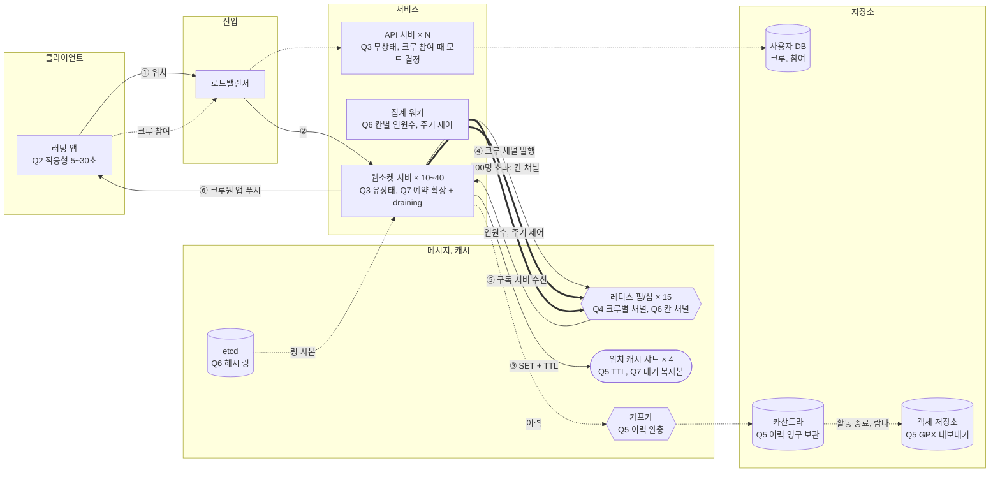

# 2장 주변 친구 - 래한, S3 같이달려

> **한 줄 요약**: 웹소켓 + 크루별 레디스 펍/섭으로 5초 위치를 전파하고, 이력은 카프카를 거쳐 카산드라에 영구 보관하며, 3만 명 대회 크루는 지오해시 칸 채널로 쪼갠다.

## 1. 전제

| 핵심 숫자 | 값 | 계산식 |
|---|---|---|
| 위치 갱신 QPS | 피크 8만/초 (평소 2만) | 200만 × 20% = 40만 동시 접속, / 5초 |
| 초당 전파 메시지(팬아웃) | 152만/초 | 8만 × 19명(크루 20명 중 나 제외), 전원 반경 안 |

- **교재와 다른 제약**: 5초 갱신에 연속 2회 유실은 불만. 공유 단위가 친구가 아니라 크루(평균 20명, 최대 100명)이고 거의 전원이 반경 안. 활동 기록(경로)이 핵심 기능이라 영구 보관

## 2. 결정 7개

| # | 결정 | 내 선택 | 근거 (한 줄) | 감수한 것 |
|---|---|---|---|---|
| Q1 | 규모 | 피크 동시 40만, 갱신 8만/초, 팬아웃 152만/초. 쓰기와 푸시 위주 | 단말이 5초마다 쓰고 서버가 밀어 준다. 한 건이 19건이 되니 팬아웃이 먼저 병목 | 피크(평소 4배) 기준으로 서버를 잡는다 |
| Q2 | 갱신 주기, 활성 판단 | 적응형(자전거 5초가 가장 짧은 주기, 걷기 10초, 정지 30초), 1회 유실 허용 + 보간 / 활동 시작, 종료 명시 + 예정 시각 기준 TTL | 클라이언트가 속도를 아니 주기를 고른다. 멈춘 사람의 중복 전송이 가장 큰 낭비 | 서버는 전원 5초인 최악으로 잡는다. 갱신마다 다음 예정 시각을 함께 보내야 TTL이 맞는다 |
| Q3 | 통신 방식, 서버 구조 | 웹소켓 / 무상태 API 서버 + 유상태 웹소켓 서버 분리. 활동 시작 때 1번 + 주기마다 전송 | 5초 주기면 전송이 많아 요청마다 헤더가 붙는 POST보다 열린 연결이 낫다 | 웹소켓 서버가 유상태라 배포와 축소 때 연결을 빼야 한다 |
| Q4 ★ | 위치 변경 전파 | 레디스 펍/섭, 크루별 채널. 활동 시작 때 내 크루 채널 하나 구독, 거리 필터 없음 | 발행 즉시 전달되고 저장을 안 해 가볍다. 1회 유실은 허용이라 맞다. 크루별 채널이면 레디스가 보내는 횟수가 크루원 수가 아니라 서버 수 | 구독 서버가 죽은 순간은 유실. D도 고려하되 가면 얼랭이 아니라 엘릭서로 |
| Q5 | 위치 저장소 | 최신 위치는 레디스(`user_id` -> 위도, 경도, 시각, 예정 시각) + TTL / 이력은 조합: 카프카(완충) -> 카산드라(저장), 활동 종료 이벤트로 람다(단계가 많으면 Step Functions)가 GPX로 묶어 객체 저장소에 두고 내보내기 | 최신 값은 날아가도 5초 뒤 다시 찬다. 이력은 사용자 소유라 잃으면 안 되고 피크 8만/초를 완충해야 한다. 카산드라가 죽어도 카프카에 남는다 | 카프카 운영이 하나 늘고 이력은 몇 초 늦게 반영. 데이터 두 벌 |
| Q6 | 펍/섭 클러스터 확장 (돌발) | 메모리 8MB, CPU 15대(최악 152만 push/초). 해시 링 + etcd. 대회 크루는 지오해시 칸 채널(`crew:ID:cell:지오해시`)로 전환해 내 칸 + 앞뒤 칸 구독, 밀집 칸은 인원수 + 샘플 50명, 고른 몇 명은 사용자별 채널로 따로 구독. 모드와 주기 전환은 API 서버가 참여 때 인원을 보고 내려 주고, 밀집은 집계 워커가 칸 채널에 제어 메시지 | 채널 하나는 서버 한 대에 놓여 쪼개지지 않는다. 3만 명 전원에게 전원을 보내면 단말이 초당 6천 건을 받아 서버 이전에 단말이 죽는다 | 멀리 있는 참가자와 샘플 밖 사람은 안 보인다. 칸을 넘을 때 재구독이 생긴다 |
| Q7 | 실시간 서버와 캐시 확장 | 웹소켓 서버 평소 10대, 주말 새벽 예약 확장으로 40대 + 지표 자동 확장. 배포와 축소는 draining, 몇 대씩 / 캐시는 사용자 ID 샤딩 4개 + 샤드별 대기 복제본 | 피크가 예측되니 미리 띄우고, 늘리기는 쉬우니 처음부터 많이 띄울 이유가 없다. 쓰기 8만/초는 한 대 한계에 가깝다 | 예측 밖 급증은 자동 확장이 따라올 때까지 연결이 몰린다. 재접속 폭주는 몇 대씩 내려 피한다 |

> 바뀐 결정: Q4 크루별 채널 → 크루별 + 100명 넘으면 지오해시 칸 채널 (돌발), Q2 큰 크루는 주기 완화 (돌발)

## 3. 시스템 전체 설계도

실선 = 위치 갱신 전파, 점선 = 쓰기와 비동기, 굵은 선 = 돌발 대응

**위치 갱신 -> 크루원 화면 반영**: ① 앱이 적응형 주기로 위치와 다음 예정 시각 전송 -> ② 로드밸런서가 붙어 있는 웹소켓 서버로 -> ③ 위치 캐시 갱신(TTL은 예정 시각 기준, 이력은 카프카로 비동기) -> ④ 내 크루 채널에 발행 -> ⑤ 크루원이 붙은 웹소켓 서버들이 수신 -> ⑥ 각 서버가 자기 크루원 앱에 푸시(거리 필터 없음, 앱이 보간)

## 4. 교재와 다르게 간 곳

| 결정 | 교재 | 나 | 이 시나리오에서 왜 |
|---|---|---|---|
| 채널 단위 (Q4, Q6) | 사용자별 채널, 구독 측 거리 필터 | 크루별 채널, 100명 넘으면 지오해시 칸 채널 | 크루 전원이 전부 받으니 거리 필터가 없고, 레디스 전송 횟수가 서버 수로 준다. 3만 명 크루는 쪼개야 한다 |
| 이력 저장 (Q5) | 웹소켓 서버가 카산드라에 바로 | 카프카 -> 카산드라 -> GPX 파일 | 이력이 핵심 기능이다. 피크 8만/초를 완충하고 카산드라 장애에도 잃지 않는다 |
| 갱신 주기 (Q2) | 고정 30초 | 적응형 5~30초, 예정 시각 기준 TTL | 자전거는 30초에 250m를 간다. 멈춘 사람의 5초 전송은 낭비 |

## 5. 미팅 안건

- **가장 자신 없는 결정**:
- **같이 이야기할 질문**: 대회 크루를 칸 채널과 샘플 50명으로 줄인 뒤에도 출발 직후 한 칸에 수천 명이 몰리면, 칸을 더 잘게 쪼개는 것과 주기를 늦추는 것 중 무엇을 먼저 쓰나?
