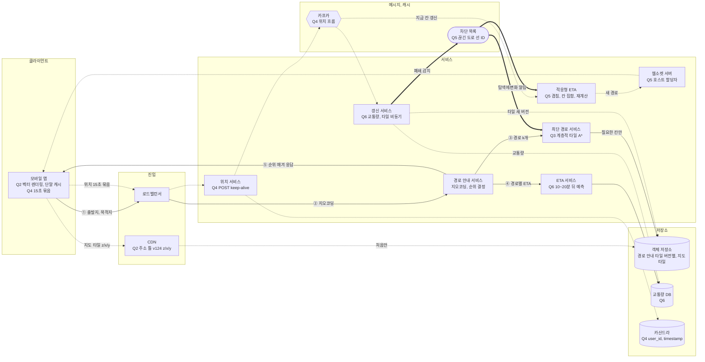

# ch03 미팅과제

> **한 줄 요약**: 벡터 타일과 서버가 주는 주소 틀로 데이터를 아끼고, 계층적 경로 안내 타일 A\*로 길을 찾은 뒤 ETA를 따로 붙이며, 끊긴 도로는 차단 목록으로 먼저 막고 3단계 확인으로 영향받는 사용자에게 웹소켓으로 알림

## 1. 전제

| 핵심 숫자 | 값 | 계산식 |
|---|---|---|
| 위치 갱신 QPS (피크) | 100만 | 10억 × 35분 / 7 = 하루 50억 분, × 60 / 10만 = 300만, / 15 = 20만, × 5 |
| 지도 데이터 트래픽 | 1인 분당 1.25MB, 전체 초당 62.5GB | 50억 분 × 1.25MB = 하루 6.25PB, / 10만 초 |

- **시나리오**: S2 월드맵 (전 세계, DAU 10억, 자동차, 도보, 자전거, 대중교통)
- **교재와 다른 제약**: 신흥국 사용자가 많아 모바일 데이터 요금에 민감함. 1인 주당 지도만 약 44MB(35분 × 1.25MB)

## 2. 결정

| # | 결정 | 내 선택 | 근거 (한 줄) | 감수한 것 |
|---|---|---|---|---|
| Q1 | 규모 | 위치 갱신 피크 100만 QPS(쓰기), 지도 타일 초당 62.5GB(읽기) | 위치는 요청 수가, 지도는 전송량이 큼. 1인 주당 지도 약 44MB라 데이터 요금이 문제임 | 15초 묶음이라 서버가 아는 위치가 최대 15초 늦음 |
| Q2 | 지도 표시 | 벡터 타일 + 단말 렌더링, 단말 캐시 / 앱이 지금 확대 수준과 위치로 z/x/y 칸 번호를 계산하고, 주소 틀(버전 포함)은 앱을 켤 때 서버 설정으로 받음 | 데이터가 크게 줄고 타일 한 벌로 전 세계 언어 대응함. 칸 경계는 고정 격자 공식이라 칸마다 서버에 묻지 않고, 주소 틀을 서버가 주니 앱 업데이트 없이 버전과 도메인을 바꿈 | 단말 CPU, 배터리를 더 씀. 저사양 기기 대응 필요. 버전을 올리면 모든 칸 주소가 새것이 되어 첫 요청이 원본으로 몰림 |
| Q3 ★ | 경로 탐색 | 도로 그래프를 칸으로 나눈 계층적 경로 안내 타일 + 필요한 칸만 불러오는 A\*, 이동 수단별 비용 모델 / 최단 경로와 ETA 분리 | 그래프가 커서 통째로 못 올림. 장거리는 고속도로 계층으로 건너뛰어 탐색이 줄고, 도로 구조 결과는 캐시됨. 도보, 자전거는 같은 타일에 비용만 바꿈 | 도로 길이로 고른 후보에 교통상 가장 빠른 길이 없을 수 있음. 대중교통은 시간표 기반이라 따로 탐색 |
| Q4 | 위치 갱신, 저장 | 매초 재고 15초 묶음 POST(keep-alive), 속도 따라 주기 조절, 끊기면 단말에 쌓았다 재전송 / 카산드라(`user_id`, `timestamp`) + 카프카로 각 서비스에 전달 | 묶으면 QPS와 배터리가 줄고 데이터는 헤더만큼 줄어듦. 위치는 금방 낡아 가용성 우선. 같은 묶음을 다시 보내도 키가 같아 중복 없음 | 서버가 아는 위치가 최대 15초 늦어 경로 이탈을 늦게 앎. 카프카 운영 부담 |
| Q5 | 적응형 ETA, 경로 변경 (돌발) | 찾기: 상위 칸 체인 겹침 검사, 경로 칸 집합, ETA 재계산 3단계 / 알리기: 웹소켓(호스트 할당자), 앱 꺼진 사람은 짧은 푸시 / 돌발: 끊긴 도로 차단 목록을 탐색에 바로 반영, 해당 칸 경로 캐시 폐기, 대피 요청 우선, 같은 출발 칸과 대피소 경로 공유, 우회로 분산 | 1차는 비교 한 번이라 수백만 명도 빨리 거름. 타일 재생성은 오래 걸려 차단 목록으로 먼저 막음. 같은 곳에서 같은 대피소로 가는 사람이 많아 공유 효과가 큼 | 차단 목록이 길어지면 탐색이 느려짐. 우회로를 나눠 주면 일부는 가장 빠른 길이 아님 |
| Q6 | 교통 반영, 타일 갱신 | ETA: 지금 교통 + 이력으로 도착 시점(10~20분 뒤) 예측 / 폐쇄는 차단 목록에 먼저 넣고 Q5 흐름으로 안내 중인 사용자에게 알림, 타일은 위치 흐름과 외부 데이터로 나중에 다시 만들어 비동기 반영 / 타일에 버전을 붙여 경로 서버 캐시 교체 | 도착할 때의 교통이 중요함. 타일 재생성은 오래 걸려 기다리면 사용자가 막힌 길로 들어감. 버전을 붙이니 옛 타일과 섞이지 않음 | 위치만으로는 안 다니는 길과 닫힌 길 구분이 어려워 확인 단계 필요. 예측 모델 학습, 운영 부담 |

> 바뀐 결정: Q3 도로 길이로만 탐색 -> 끊긴 도로 차단 목록을 탐색에 반영 (돌발)

## 3. 전체 설계도

실선 = 경로 안내 요청, 점선 = 쓰기, 비동기, 지도 타일, 굵은 선 = 돌발 대응

**경로 안내 요청 -> 경로, ETA 응답**: ① 출발지, 목적지 요청 -> ② 지오코딩으로 좌표 변환 -> ③ 최단 경로 k개(필요한 칸만 불러오고 차단 목록 제외) -> ④ 경로별 ETA(교통량 DB) -> ⑤ 순위 매겨 응답

## 4. 교재와 다르게 간 곳

| 결정 | 교재 | 나 | 이 시나리오에서 왜 |
|---|---|---|---|
| 지도 표시 (Q2) | 미리 그린 래스터 + CDN, 벡터는 최적화로 덧붙임. URL은 앱 계산과 지도 타일 서비스 사이에서 열어 둠 | 벡터 기본, 앱이 z/x/y 계산 + 주소 틀은 서버 설정 | 데이터 요금에 민감하고 전 세계 언어를 타일 한 벌로 처리함. 칸마다 묻지 않고 앱 업데이트 없이 버전 교체 |
| 영향받는 사용자 찾기 (Q5) | 바뀐 칸이 마지막 칸 안에 있는 사용자만 대상 | 겹침 검사 + 경로 칸 집합 + ETA 재계산 3단계 | 바뀐 칸이 더 크면 놓치고, 큰 칸 안이라고 다 지나는 것은 아님 |
| 끊긴 도로 (Q5, Q6) | 타일은 위치 흐름으로 비동기 갱신. 일시 폐쇄는 다루지 않음 | 차단 목록을 탐색에 바로 반영하고 타일은 나중에 | 타일 재생성은 오래 걸려 기다리면 막힌 길로 안내함 |

## 5. 미팅 안건

- **가장 자신 없는 결정**:
- **같이 이야기할 질문**: 경로 후보를 도로 길이로만 뽑으면 지진처럼 도로가 대량으로 끊길 때 후보 k개가 전부 막힐 수 있음. 차단 목록으로 충분한가, 탐색 가중치에 교통을 넣는 구조(CRP처럼 영역 나누기와 가중치 채우기를 분리)로 가야 하나?
