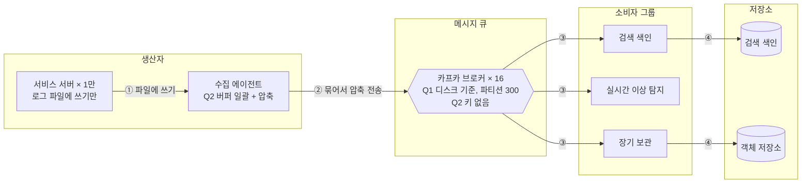

# ch04 미팅과제

> **한 줄 요약**: 로그는 키 없이 파티션 300개에 고르게 넣고, 수집 에이전트가 묶어서 압축해 보내며, 브로커 수는 2주 보관 용량(2.1PB)이 정한다. 복제와 ACK, 소비와 전달 보장(Q3, Q4)은 이어서 정한다

## 1. 전제

| 핵심 숫자 | 값 | 계산식 |
|---|---|---|
| 피크 쓰기 처리량 | 1.5GB/s (150만 건/s) | 50만 건/s × 1KB × 3 |
| 2주 저장량 (사본 3개) | 2.1PB | 500MB/s × 10만 초 = 하루 50TB, × 14일 × 3 |
| 필요한 파티션 수 | 150 (넉넉히 300) | 처리량 1.5GB/s ÷ 10MB/s, 소비자 150만 건/s ÷ 1만 건/s |
| 브로커 수 | 약 16대 (디스크 기준) | 2.1PB ÷ 브로커 한 대 약 130TB. 네트워크 기준(나가는 쪽 7.5GB/s)은 약 4대 |

- **시나리오**: S1 로그창고 (서버 1만 대의 로그와 지표, 소비자 그룹 3개: 검색 색인, 실시간 이상 탐지, 장기 보관)
- **교재와 다른 제약**: 로그 0.1% 이하 유실은 허용, 대신 생산자(서비스 서버)가 느려지면 안 된다

## 2. 결정

| # | 결정 | 내 선택 | 근거 (한 줄) | 감수한 것 |
|---|---|---|---|---|
| Q1 | 규모 | 피크 1.5GB/s, 2주 2.1PB, 파티션 150 이상(넉넉히 300) | 브로커 수는 디스크(16대)와 네트워크(4대) 중 큰 쪽, 여기선 디스크가 정한다. 소비자 수는 파티션 수만 정한다 | 브로커 장애 시 수십 TB 재복제. 압축, 계층형 저장소로 줄인다 |
| Q2 | 파티션 키, 생산자 전송 | 키 없음(고르게 분산) / 서비스는 로그 파일에만 쓰고, 수집 에이전트가 버퍼에 모아 일괄 전송 + 압축 | 로그라 고르게 넣고 순서는 찍힌 시각으로 맞춘다. 처리량이 최우선이고 서비스는 카프카 때문에 막히면 안 된다 | 같은 서버 로그의 순서 보장 없음. 버퍼가 차면 오래된 로그를 버린다 |
| Q3 ★ | 복제와 ACK | 진행 중 | | |
| Q4 | 소비 방식, 전달 보장 (돌발) | 진행 중 | | |

> 바뀐 결정: Q2 키를 서버 ID -> 키 없음 (장애 때 몇 서버가 로그를 쏟으면 그 파티션만 몰려서)

## 3. 전체 설계도

Q3, Q4를 정한 뒤 복제, ACK, 소비 방식을 더한다.

실선 = 로그 수집에서 소비까지, 점선 = 쓰기와 비동기, 굵은 선 = 돌발 대응

## 4. 교재와 다르게 간 곳

| 결정 | 교재 | 나 | 이 시나리오에서 왜 |
|---|---|---|---|
| 순서 | 생산된 순서대로 소비 (키별 파티션) | 키 없음, 순서 보장 안 함 | 로그는 대략 순서면 되고 시각으로 다시 맞춘다. 장애 때 핫 파티션을 피한다 |
| 생산자 | 서비스가 클라이언트 라이브러리로 직접 보냄 | 서비스는 파일에만 쓰고 수집 에이전트가 보냄 | 카프카가 느려져 버퍼가 차도 서비스는 막히면 안 된다 |

## 5. 미팅 안건

- **가장 자신 없는 결정**: Q3, Q4를 마친 뒤 적는다
- **같이 이야기할 질문**: 브로커 수를 디스크(16대)가 정했는데, 압축과 계층형 저장소를 쓰면 그다음엔 무엇이 브로커 수를 정하나?
