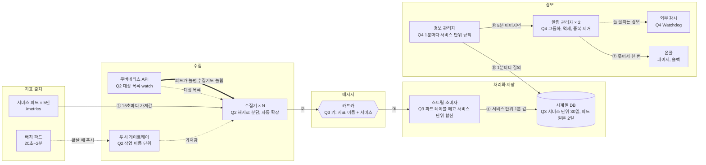

# 5장 지표 모니터링 및 경보 시스템 - 래한, S2 컨테이너

> **한 줄 요약**: 서비스 파드는 풀, 배치만 푸시 게이트웨이로 모으고, 카프카 뒤 스트림에서 파드 레이블을 떼어 서비스 단위로 합쳐 시계열 수를 줄이고, 경보는 서비스 단위 규칙에 그룹화와 억제를 건다.

## 1. 전제

| 핵심 숫자 | 값 | 계산식 |
|---|---|---|
| 활성 시계열 / 초당 포인트 | 1,500만 / 초당 100만 | 파드 5만 × 지표 300, ÷ 15초 |
| 하루 원본 | 1.6TB | 100만 × 10만 초 × 16B |
| 30일 저장량 (다운샘플링 후 / 전) | 약 20TB / 48TB | 7일 × 1.6TB + 23일 × 0.4TB (15초 -> 1분은 1/4) |
| 하루 새 시계열 | 1억 5천만 (30일이면 약 45억) | 새 파드 50만 × 300 |

- **교재와 다른 제약**: 파드가 수시로 생기고 사라지고 20초 만에 끝나는 배치 작업이 있다. 파드 이름 레이블 때문에 하루에 새로 생기는 시계열이 살아 있는 시계열의 10배다

## 2. 결정 4개

| # | 결정 | 질문 | 내 선택 | 근거 (한 줄) | 감수한 것 |
|---|---|---|---|---|---|
| Q1 | 규모 | 파드 5만 × 300, 15초면 시계열, 초당 포인트, 30일 저장량은? 무엇이 먼저 한계에 도달하나? | 시계열 수(색인)가 먼저 한계에 도달한다 | 쓰기 초당 100만과 20TB는 늘리면 되지만, 파드가 바뀔 때마다 새 시계열이 생겨 색인이 먼저 찬다 | - |
| Q2 ★ | 수집 방식 | 파드가 수시로 바뀌고 배치는 20초 만에 끝나는데(수집 15초) 어떻게 모으고 수집기는 어떻게 나누나? | 혼합: 서비스 파드는 풀(쿠버네티스 API watch + 해시로 수집기 분담), 배치만 푸시 게이트웨이(작업 이름 단위), 수집기는 대상 수에 맞춰 자동 확장 (돌발) | 풀은 /metrics 디버깅, up으로 상태 진단, 목록에 있는 대상만 받는다. 배치는 15초 수집 전에 끝나 마지막 값을 못 가져간다 | 게이트웨이가 끝난 작업의 마지막 값을 계속 들고 있고(마지막 성공 시각으로 판단), 게이트웨이가 단일 장애 지점 |
| Q3 | 파이프라인, 줄이기 | ① 초당 100만 포인트를 수집기와 DB 사이에 무엇을 두고 받나, 파티션 기준은? ② 어디서 언제 줄이나? | ① 카프카(키: 지표 이름 + 서비스) ② 지표마다: 서비스 단위 지표는 스트림에서 파드 레이블을 떼고 합쳐 30일, 파드 원본은 2일만 두고 질의 시점, 다운샘플링은 최소, 최대, 합계, 개수(지연은 히스토그램) | ① DB가 멈춰도 카프카에 남고 같은 서비스의 파드 값이 한 파티션에 모여 소비자가 혼자 합친다 ② 시계열 수가 파드 기준에서 서비스 기준으로 준다, 평균만 두면 튄 값이 묻힌다 | 카프카 운영과 지연, 늦게 온 값 처리, 합친 뒤에는 파드 단위로 다시 볼 수 없다 |
| Q4 | 경보 | (돌발: 파드 20만, 경보 수천 건) ① 규칙은 어디서 어떻게 평가하고 데이터 없음은? ② 쏟아지는 경보를 어떻게 줄이고 확실히 보내나? | ① 경보 관리자가 1분마다 서비스 단위 규칙을 질의(파드별 CPU 규칙은 없앰), 데이터 없음은 대상마다 울리지 않고 수집기 지연 경보 하나로 ② 서비스별 그룹화, 수집기 지연이 데이터 없음을 억제, 상태 저장으로 중복 제거, 등급별 전달, 알림 관리자 2대와 재시도, Watchdog 외부 감시, 침묵은 미리 아는 일정에만 끝 시각을 걸어 | 평가는 1분마다 해도 알림은 상태가 바뀔 때만 가고, 사람에게는 원인 경보 하나만 간다 | 묶음 안의 다른 원인이 묻힐 수 있고, 억제 규칙이 틀리면 진짜 경보도 막힌다 |

## 3. 시스템 전체 설계도

실선 = 지표 수집에서 경보 발령까지, 점선 = 부가 흐름과 비동기, 굵은 선 = 돌발 대응

**지표 수집 -> 경보 발령**: ① 수집기가 서비스 파드의 /metrics를 15초마다 가져간다 -> ② 카프카에 지표 이름 + 서비스 키로 넣는다 -> ③ 스트림 소비자가 파드 레이블을 떼고 서비스 단위로 합친다 -> ④ 시계열 DB에 1분 값을 쓴다 -> ⑤ 경보 관리자가 1분마다 서비스 단위 규칙을 질의한다 -> ⑥ 위반이 5분 이어지면 알림 관리자로 보낸다 -> ⑦ 그룹화, 억제, 중복 제거 뒤 온콜에 한 번 알린다

## 4. 교재와 다르게 간 곳

| 결정 | 교재 | 나 | 이 시나리오에서 왜 |
|---|---|---|---|
| 수집 | 풀 또는 푸시 중 하나 | 서비스는 풀, 배치만 푸시 게이트웨이 | 20초짜리 배치는 15초 수집 전에 끝나 마지막 값을 못 가져간다 |
| 집계 | 원본을 저장하고 다운샘플링 | 서비스 단위는 스트림에서 합치고 파드 원본은 2일 | 파드 이름 레이블로 하루에 새 시계열이 1억 5천만 개 생긴다 |
| 경보 | 인스턴스 단위 병합, 중복 제거 | 서비스 단위 규칙, 억제, 외부 감시 | 파드 단위 경보는 소음이고 파드가 늘면 수천 건이 된다 |

## 5. 미팅 안건

- **가장 자신 없는 결정**:
- **같이 이야기할 질문**: 파드 원본을 2일만 두면 일주일 전 특정 파드에서 생긴 문제는 무엇으로 조사하나? 로그와 추적으로 충분한가?
